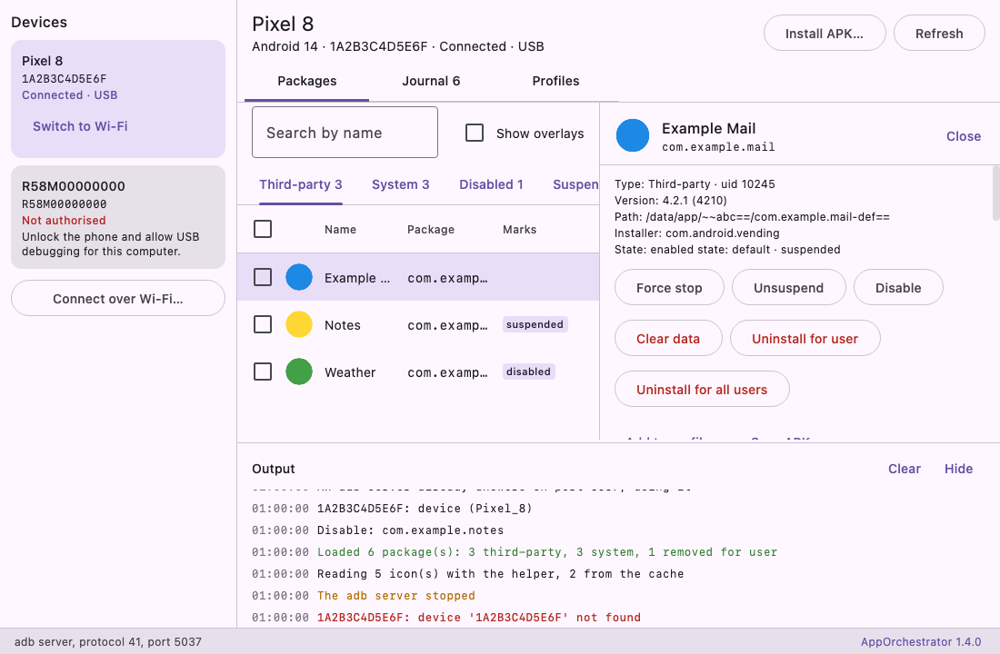
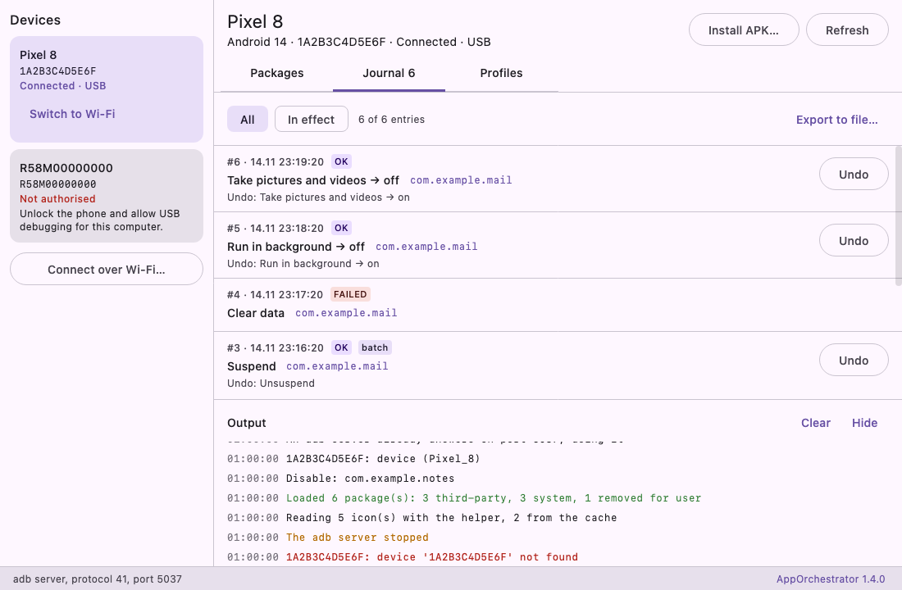
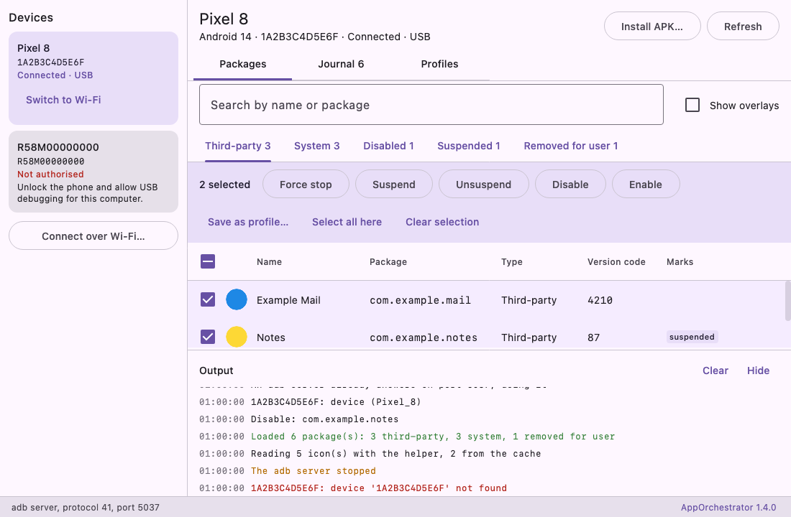
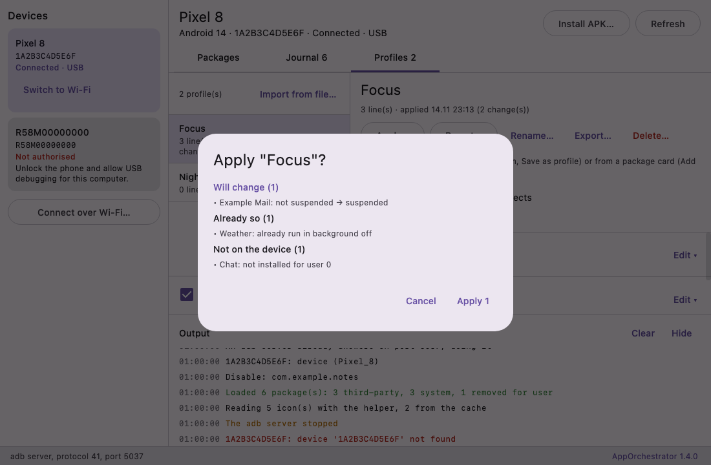
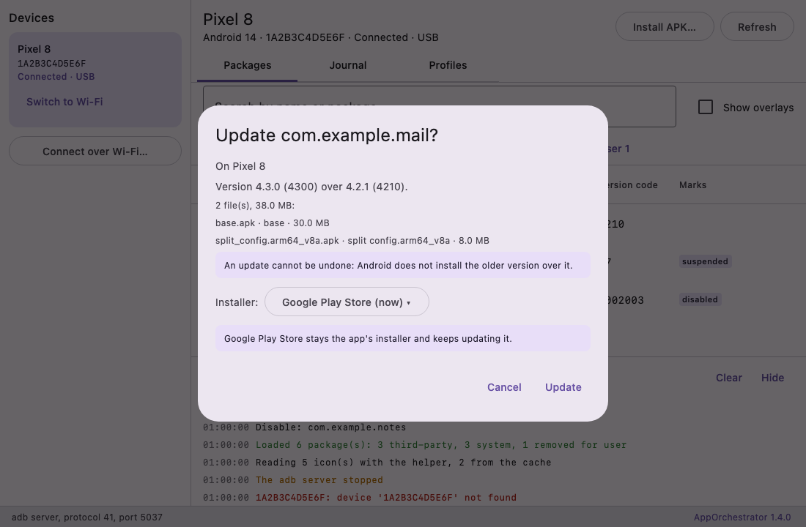

# AppOrchestrator user guide

AppOrchestrator manages the apps on your Android phone from your computer. It can stop, suspend,
disable and restrict them, change their permissions, battery and language settings, install APK
files, run batches and profiles, and keep a journal that undoes every change. It works over USB
debugging (or Wireless debugging), with no root and nothing installed on the phone.

How to download, start AppOrchestrator and connect a phone is on the
[download page](README.md). This guide is about using it.

## Contents

1. [How it works](#1-how-it-works)
2. [The window](#2-the-window)
3. [The package list](#3-the-package-list)
4. [The package card](#4-the-package-card)
5. [What each action does](#5-what-each-action-does)
6. [Protection and confirmations](#6-protection-and-confirmations)
7. [The journal and undo](#7-the-journal-and-undo)
8. [Batch actions](#8-batch-actions)
9. [Profiles](#9-profiles)
10. [Installing APK files](#10-installing-apk-files)
11. [Troubleshooting](#11-troubleshooting)
12. [Limits](#12-limits)
13. [Privacy](#13-privacy)

## 1. How it works

Android lets a computer control a phone over ADB (Android Debug Bridge) once **USB debugging** is
on and the phone trusts the computer. AppOrchestrator talks to `adb` on your computer and runs the
same commands you could type after `adb shell`: `pm`, `appops`, `cmd`. It has the rights of that
shell, not root.

To show app names, icons and languages, it puts a small helper program in the phone's temporary
folder (`/data/local/tmp`) and runs it there. Nothing is installed on the phone, and nothing stays
running after AppOrchestrator is closed.

Before every change AppOrchestrator reads the app again and writes the change into the phone's
journal, so that it can be undone. Each phone has its own journal on the computer.

## 2. The window

* **Devices**, on the left: every phone adb sees, with its state. Click one to work with it. A
  phone on the cable has **Switch to Wi-Fi**, a phone over Wi-Fi has **Disconnect**.
  **Connect over Wi-Fi…** adds a phone without a cable ([download page](README.md#over-wi-fi)).
* **The selected phone**: its model, Android version and how it is connected. **Install APK…** and
  **Refresh** are at the top right.
* **Tabs**: **Packages**, **Journal** and **Profiles** of that phone. The number is how many entries
  or profiles there are.
* **Output**, at the bottom: what AppOrchestrator does, in words: which app it changes, what it
  copies, what went wrong. Drag its top edge to make it taller; **Hide** folds it away.
* **The status bar**: whether the adb server runs, and on which port. On the right, the app's
  version: click it for **About** (on macOS also **AppOrchestrator → About AppOrchestrator** in the
  menu bar). About shows the version, the Java and the system it runs on, and the folder with the
  app's files (**Open folder**), with links to the download page and the terms of use. **Copy
  details** puts the version, Java and system on the clipboard, for a report.

Keys: **F5** or **Ctrl+R** (**Cmd+R** on macOS) reads the list again, **Ctrl+F** (**Cmd+F**) goes to
the search, **Escape** closes the card or clears the selection.

## 3. The package list

* **Tabs**: *Third-party*, *System*, *Disabled*, *Suspended*, *Removed for user*. The number is how
  many apps are in the tab.
* **Search** looks at the app name and the package name, in every tab at once.
* **Show overlays**: overlay packages (themes and resource overlays) are hidden by default.
* **Marks**: `suspended`, `disabled`, `archived`, `updated` (a system app with an update installed),
  `priv-app` (a privileged system app), `overlay`, `protected`.
* Click a row to open its [card](#4-the-package-card) on the right.
* Tick the box at the start of a row to select it for a [batch action](#8-batch-actions).

The list is read when the phone connects, on **Refresh**, after AppOrchestrator's own changes, when
you come back to the window after more than 30 seconds, and when a check every 5 seconds sees that
something changed on the phone itself.

## 4. The package card

The top shows the type, uid, version, install path, installer and state. Below are:

* **Buttons** for one-off actions. Which ones appear depends on the app: an updated system app has
  **Uninstall updates**, a removed one has **Restore for user**.
* **Add to profile…**: save one of this app's states into a [profile](#9-profiles).
* **Save APK…**: save the app to a file on the computer, to [install it again](#save-apk) later.
* **Permissions**: a switch per runtime permission, with Android's own name and description in the phone's language. Permissions fixed by the system are greyed out.
* **Special access**: what Android lists under *Special app access* (display over other apps, usage
  access, all files access, alarms and reminders…), only what the app asks for, each with its switch.
  See [Special access](#special-access).
* **Background**: *Run in background*, *Background services (legacy apps)*, *Battery optimization*,
  *Background mobile data*, and on Xiaomi phones *MIUI battery saver*.
* **Network**: *Internet access*.
* **Notifications**: *Show notifications*.
* **Links**: *Open supported links*, only for apps that open web addresses.
* **Language**: the app's own language (Android 13+).

Some apps share one uid (*shared uid*; mostly system apps, such as Google Play services and Google
Services Framework), and Android keeps some settings for the whole uid. On such an app *Background
mobile data*, *Internet access* and *Battery optimization* say *whole shared uid …* right after the
state, and *Permissions* says so above its list: a change there applies to every app of that uid.
A *Special access* row says *set for its whole uid* when the uid's setting overrules the app's own.
Such an app's card has a **Shared uid** section under the buttons: the uid's name and number, and
**Show all … apps**, which lists the other apps of that uid; click one to open its card. An app alone
in its shared uid gets one line, *no other app on this phone*, and no notes about the uid.

Each action reads the app again before it runs, so a card that is a few minutes old is never
dangerous. A switch moves as soon as you click it, and the change itself takes a fraction of a second:
only that setting is read, before and after. If the change does not go through, the switch goes back.

A change that went through is said at the bottom of the card, over it, for about ten seconds: in an
oval with **Undo** on its right, the same as undoing it from the journal, or, when it cannot be undone
from there, in a plain box. Nothing on the card moves, so the next click lands where you aim. The card's
other messages (an app added to a profile, MIUI's battery page opened on the phone) show there too, in
the plain box, and an APK file saved in an oval with **Show in folder**. So do the messages of the
journal, the profiles and the app list (an undo done, a profile applied or exported, apps saved to a
profile). What did not go through (refused, failed, nothing to do) is said at the top instead, and
stays there until the next action.

## 5. What each action does

For each action: what it does in plain words, when it helps, what to watch out for and how to undo
it. Under **How it works** is the exact command.

### Force stop

Closes the app at once, like **Force stop** in Settings. It stays stopped until something starts it
again: you, a notification, another app. Useful when an app hangs or drains the battery. Nothing to
undo.

How it works

`am force-stop --user 0 <package>`

### Suspend / Unsuspend

A suspended app stays installed with all its data, but its icon turns grey: it cannot be opened, it
does not run, and its notifications are hidden. Useful for apps you want out of the way for a while,
like games during work. **Unsuspend** brings it back exactly as it was.

Android keeps a separate suspension for each one who suspends an app, and only that one can lift it.
If root or another app (such as Digital Wellbeing) suspended it, the **State** line says who, for
example *suspended by root*, a note explains it, and there is no **Unsuspend** button.

How it works

`pm suspend --user 0 <package>` / `pm unsuspend --user 0 <package>`. `dumpsys package` lists who
suspended it (`suspendingPackage=`): `com.android.shell` for adb and AppOrchestrator, `root` for a root
shell.

### Disable / Enable

A disabled app disappears from the launcher and cannot run at all, as if removed, but it stays on
the phone with its data. Useful for preinstalled apps you never use. Disabling a system component
can break features that depend on it, which is why system parts are protected
([section 6](#6-protection-and-confirmations)). **Enable** turns it back on.

How it works

`pm disable-user --user 0 <package>` / `pm enable --user 0 <package>`. Undo puts back the exact
state from before: `pm default-state` for an app that was in its default state. The shell can only
set "disabled by user", so an app that was disabled in another way comes back as "disabled by
user"; the journal marks such an undo as approximate.

### Clear data

Deletes everything the app has stored: sign-ins, settings, downloaded files, caches. The app starts
as if freshly installed. **Cannot be undone**; it always asks first.

How it works

`pm clear --user 0 <package>`

### Archive / Restore from archive (Android 15+)

Archiving removes the app itself (its APK) and its cache but **keeps its data, sign-ins and settings,
and its icon**. To use it again, tap the icon on the phone or press **Restore from archive**: the
store that installed it (for example Google Play) downloads it again and it opens as before. Useful
to free space taken by apps you rarely use without setting them up again later. The list shows
archived apps under *Removed for user* with the `archived` mark.

Watch out: restoring needs the internet, and the app must still be available in its store. Apps
installed from an APK file have no store to come back from, so they cannot be archived. Archiving is
never done in batches or profiles.

How it works

`pm archive --user 0 <package>` / `pm request-unarchive --user 0 <package>`. The restore is done by
the store after the command returns.

### Uninstall for user / Restore for user

Removes the app for you (user 0) and keeps its files on the phone where the system allows.

* **System apps** keep their copy on the phone, so they can always be restored from the *Removed for
  user* tab with **Restore for user**.
* **Third-party apps** that another user or work profile on the phone still has can be restored the
  same way, while that user keeps the app.
* **Third-party apps that only you have** lose their APK too. AppOrchestrator copies the APK files to
  the computer first, into the phone's folder ([where](README.md#where-apporchestrator-keeps-its-files)):
  if the copy fails, nothing is uninstalled. **Undo** in the journal installs the app again for you
  from that copy, with the store it came from. Android keeps the app's data when it is removed for
  one user, so it comes back with its data.

The confirmation tells you which case applies.

How it works

`pm uninstall -k --user 0 <package>` / `cmd package install-existing --user 0 <package>`. For an app
only you have, the undo is `pm install -r --user 0 -i <installer> <files>` with the saved copy. App
clones (for example Xiaomi's Second space for apps) do not count as another user: they lose their
copy together with you.

### Disable or uninstall for user?

| | Disable | Uninstall for user |
|---|---|---|
| The app | Stays installed but cannot run: no icon, no services, no notifications. | Is not installed for you any more. |
| Who sees it | The phone's Settings list it as disabled; other apps see it is there. | The phone's Settings and other apps do not see it. |
| Tab | *Disabled* | *Removed for user* |
| Back | **Enable**, any time. | **Restore for user** for system apps and apps another user keeps; **Undo** in the journal, from the saved APK, for apps only you had. |

Disable is the safe choice for preinstalled apps you do not use. Uninstall for user removes a system
app more thoroughly, and is still reversible.

**If an app cannot be disabled.** Disabling and uninstalling go through different checks in
Android, so one can be refused when the other is not:

* In the phone's own Settings the **Disable** button is greyed out for many preinstalled apps: apps
  signed by the system, the default launcher or SMS app, device administrators, and apps on the
  maker's list. Settings usually offers no "uninstall for this user" for system apps at all.
  AppOrchestrator does not go through these Settings rules, so **Disable** may work here where
  Settings does not allow it.
* Android itself, and the phone's maker with its own list, can refuse the disable command for some
  packages. AppOrchestrator then shows the phone's answer as it is, for example a
  `SecurityException` or `Cannot disable`. Uninstall for user takes another path and is often
  allowed for the same app; for a system app it can be undone with **Restore for user**.

### Uninstall for all users

Removes a third-party app and its data for **every** user of the phone, including the work profile
and app clones. To confirm, you type the package name.

Before uninstalling, AppOrchestrator copies the app's APK files to the computer, into the phone's
folder ([where](README.md#where-apporchestrator-keeps-its-files)). If the copy fails, nothing is
uninstalled. **Undo** in the journal installs the app again from that copy, with the store it came
from. **The app's data cannot come back.**

How it works

`pm path <package>`, the files copied over adb, then `pm uninstall <package>`. Undo pushes the copies
back to `/data/local/tmp`, runs `pm install -r -i <installer> <files>` and removes them again.

### Uninstall updates

For a system app with an update installed: removes the update and the app's data, and goes back to
the version the phone shipped with. The update comes back only from the store. **Cannot be undone.**

How it works

`pm uninstall <package>` on an updated system package.

### Permissions

Each switch grants or revokes one runtime permission (camera, location, contacts…). Its name and
description are Android's own, in the phone's language, as the phone's settings word them; below them
is the permission's system name, such as `android.permission.CAMERA`. A permission Android has no
text for shows only its system name. A revoked permission is not final: the app can ask again and
the system shows its usual dialog. Permissions the system fixed cannot be changed: their switches
are grey, and the card says "fixed by the system". For apps that share a uid (some system apps), the
change applies to all of them, and the card says so.

How it works

`pm grant --user 0 <package> <permission>` / `pm revoke --user 0 <package> <permission>`. The texts
come from `pm list permissions -g -d -f`, read once, with the first package list: after a change of
the phone's language, restart AppOrchestrator to see them in the new one.

### Special access

The same switches as under *Settings → Apps → Special app access* on the phone (on Xiaomi phones
*Privacy protection → Special permissions*), for one app. The card shows only what the app asks for:

| Row | The app may… |
|---|---|
| Alarms & reminders (Android 12+) | set alarms and reminders that go off at an exact time, even while the phone sleeps |
| All files access (Android 11+) | read, change and delete every file in the phone's shared storage |
| Display over other apps | draw its windows on top of other apps |
| Full screen notifications (Android 14+) | show notifications that fill the screen and turn it on, as calls and alarms do |
| Install unknown apps | ask to install other apps |
| Modify system settings | change system settings such as brightness, ringtone and screen timeout |
| Picture-in-picture | keep a video or a call in a small window on top of other apps when you leave it |
| Turn screen on (Android 13 only) | turn the screen on by itself |
| Usage access | see which apps you use, how often and for how long |
| Wi-Fi control | turn Wi-Fi on and off, scan for networks and connect to them |

*Picture-in-picture* appears for apps that have such a window. *Turn screen on* is there on Android
13 only: older versions do not check it at all, and Android 14 and newer let every app turn the
screen on whatever it says, so its switch would change nothing.

Each row says *Allowed* or *Not allowed* and what that means, then Android's name for it and the
modes the phone keeps (`SYSTEM_ALERT_WINDOW: ignore, uid: allow`). *The system grants it to this
app* means the app has it without anybody switching it on. A switch here changes the same setting as
Android's own page, so the phone's Settings show the change too. Before you allow *Install unknown
apps* or *Usage access*, the card warns you as Android does. Xiaomi phones switch *Display over other
apps* and *Modify system settings* off for every newly installed app.

Android keeps some of these settings for the app and some for its whole uid, and a setting of the
uid wins. When an app's own setting is overruled that way, the row says *set for its whole uid*;
the phone's own page then shows only the app's setting, which says nothing about what the app may
do. The switch here clears the uid's setting, so it really changes what the app may do.

*Unknown* means the phone answered with a mode AppOrchestrator does not know (Xiaomi has one of its
own); the switch then turns it on. *Always allowed* (full screen notifications of apps built for
Android 9 and older) has no switch: Android does not ask such apps.

Undo puts back what was there before, on each level that the change touched. A profile can hold
"off" for these rows.

How it works

The state comes from `dumpsys appops --package <package>` (the setting of the app and of its uid)
and `dumpsys package <package>` (what the app asks for and what it was granted). On:
`appops set --user 0 <package> <OP> allow`, off: `… ignore`, with `--uid` for *Alarms & reminders*,
*All files access* and *Full screen notifications*, as Android's settings do. Before changing the
app's own setting, a setting of its uid is cleared: `appops set --user 0 --uid <package> <OP>` with
the operation's default mode. For *Full screen notifications* the permission also gets the
`user-set` flag, as Android's page sets it (`pm set-permission-flags`). Whether an app has a
picture-in-picture window comes from the helper the app runs on the phone.

### Run in background / Background services (legacy apps)

* **Run in background** off: the app may not run while you are not using it. This is the same as
  the *Restricted* battery setting in Settings. Good for apps that should only work while open.
* **Background services (legacy apps)** off: the same limit for apps built for old Android
  versions, which could start background services freely.

Under each switch the card says what its state means, and below that, in small print, Android's
name for it and its mode (`RUN_ANY_IN_BACKGROUND: allow`), as `appops` prints them.

Messengers and alarm clocks with these off may deliver late or not at all.

How it works

`appops set --user 0 <package> RUN_ANY_IN_BACKGROUND ignore` and the same for `RUN_IN_BACKGROUND`.
Undo sets back the mode read before (`allow`, `ignore` or `default`).

### Battery optimization

When the phone lies still with the screen off, Android goes into **Doze**: apps lose network access
and their alarms and jobs wait for short maintenance windows. Turning **Battery optimization** off
exempts the app: it keeps network and alarms while the phone sleeps. This is the *Don't optimize*
option in Settings.

Useful for messengers whose notifications come late, smart home, health trackers, alarm apps. It
costs some battery.

Some apps are exempted by the system itself: the phone's maker keeps them out of Doze, and Settings
does not let you change that. Their switch is off and says *exempted by the system*. Turning it on
takes the exemption away, after a confirmation; turning it off again gives it back. Apps that much
depends on keep theirs, and the switch is greyed out with the reason: Google Play services (it
delivers push messages for most apps), calls and SMS, emergency alerts, the clock, and apps that run
as a system uid.

Android exempts a whole uid: an app that shares its uid with others is exempt as soon as one of them
is. Its switch then says *Not optimized · through <package>, whole shared uid …* and is greyed out, as
changing this app alone would change nothing: turn battery optimization on for that package instead.
Turning it off for an app of a shared uid turns it off for the whole uid, and turning it back on does
the same unless another app of the uid stays exempt; the confirmation says which.

Android saves a change of this setting a few seconds later, and loses it if the phone falls asleep
and restarts before that. So after the change AppOrchestrator turns the phone's screen on, which
keeps it awake. Don't restart the phone right away; after that the change stays, restarts included.

On Xiaomi phones the maker's own battery saver ([MIUI battery saver](#miui-battery-saver-xiaomi))
and **Autostart** setting work on top of Doze, so this switch alone may not be enough. Autostart
cannot be changed over ADB; set it in the Security app. MIUI gives the exemption again at every
restart to apps set to *No restrictions* there, and to a few of its own apps (Weather, Mi Account,
Music and others): for them, battery optimization stays on only until the phone restarts, and the
card says so.

How it works

`cmd deviceidle whitelist +<package>` / `-<package>` changes your exemption,
`cmd deviceidle sys-whitelist -<package>` / `+<package>` the system's. `cmd deviceidle whitelist`
lists `user,<package>,<uid>` for yours and `system,<package>,<uid>` for the system's; `dumpsys
deviceidle` lists the apps whose system exemption was taken away under *Removed from whitelist system
apps*. Android exempts a whole uid: while one of its packages is exempt, all of them are. It writes
the lists to storage about 5 seconds after a change, on a timer that stops while the phone sleeps.

### Background mobile data

Off: while the app is in the background it may not use mobile data or a Wi-Fi network marked as
metered. On ordinary Wi-Fi, and while you use the app, it works as usual. This is the *Background
data* switch in the app's data usage settings. Useful to save mobile data, for example when
travelling.

Some system apps share one user ID (uid); the restriction then applies to all of them, and
AppOrchestrator asks before it does that. Apps that run as the system itself are never touched.

How it works

`cmd netpolicy add restrict-background-blacklist <uid>` / `remove …`. The restriction is on the uid,
not the package name, so the uid is read right before the change.

### MIUI battery saver (Xiaomi)

Xiaomi phones (MIUI, HyperOS) have their own battery setting for each app, apart from Android's:
**No restrictions**, **Battery saver** (the default), and two ways to restrict the app in the
background. The card shows it on Xiaomi phones. AppOrchestrator cannot change it:
**Change on the phone…** turns the phone's screen on and opens MIUI's page for the app there. Unlock
the phone and choose; the card notices the new mode by itself within a few seconds (it watches for
three minutes).

* Only **No restrictions** keeps HyperOS from freezing the app a few seconds after it leaves the
  screen (while the phone is not charging). *Battery optimization* off does not: the app is frozen
  anyway. Choose it for apps that must keep working in the background, such as messengers, alarms
  and trackers.
* **No restrictions** also exempts the app from battery optimization, again after every restart.
* MIUI's choice and Android's switches are separate: MIUI's *Restrict background* does not turn *Run
  in background* off, and the other way round. Protected apps have no button.

How it works

The mode is `bgControl` in PowerKeeper's table (`noRestrict`, `miuiAuto`, `restrictBg`, `noBg`),
read from `dumpsys activity service com.miui.powerkeeper/.PowerKeeperBackgroundService`. The shell
cannot write it: PowerKeeper's provider needs a system permission. The page is
`com.miui.powerkeeper/.ui.HiddenAppsConfigActivity` on MIUI 14, and the standard
`REQUEST_IGNORE_BATTERY_OPTIMIZATIONS` action on HyperOS, which opens Security's *Battery details*.
HyperOS freezes background apps when `persist.sys.powmillet.enable` is `true`; apps set to
`noRestrict` are skipped.

### Which one to use

These switches limit different things, and their limits add up:

| Switch | What it does | When |
|---|---|---|
| *Run in background* off | Almost no background work: jobs, alarms and background services wait until you open the app | Whenever the app is not on screen |
| *Background services (legacy apps)* off | Stops background services of apps built for old Android versions | Whenever the app is not on screen |
| *Battery optimization* off | Lifts limits instead: the app keeps network and alarms while the phone sleeps, and Android's own limits for rarely used apps do not apply to it | Mostly while the phone sleeps |
| *Background mobile data* off | No mobile data or metered Wi-Fi | While the app is in the background |
| *Internet access* off | No network at all, Wi-Fi or mobile | Always, even on screen, until the phone restarts |
| *MIUI battery saver*: No restrictions (Xiaomi) | Keeps HyperOS from freezing the app, and exempts it from battery optimization | Whenever the app is not on screen |

* Settings shows *Run in background* and *Battery optimization* as one choice of three in the app's
  battery settings: *Unrestricted* (battery optimization off), *Optimized* (both on, the default) and
  *Restricted* (run in background off). AppOrchestrator shows them as two switches. If both are off,
  battery optimization wins: Android does not hold back an exempt app. To restrict an app, keep its
  battery optimization on.
* To save battery, turn *Run in background* off for apps that only need to work while open.
* When an app's messages or reminders come late, turn *Battery optimization* off and check that *Run
  in background* is on.
* *Background mobile data* is about data use, not the battery.

How it works

An app on any Doze exemption list (`user`, `system`, even `system-excidle`) is exempt from the
`RUN_ANY_IN_BACKGROUND` limits on jobs and alarms (`AppStateTrackerImpl.areJobsRestricted` /
`areAlarmsRestricted` in AOSP), and Android puts it in the `exempted` App Standby bucket
(`am get-standby-bucket <package>` prints `5`).

### Internet access

Off: the app gets no internet at all, over Wi-Fi or mobile data, even while you use it. Useful for an
app that should only work offline, or that you want to keep from sending data. Turning it back on
gives the internet back at once.

The block lasts until the phone restarts: Android clears it then, and the switch is on again. If
the block was set from AppOrchestrator, the card then says it is gone. Turn it off again, or apply a profile that holds it. If the phone has a profile of its own,
AppOrchestrator offers it when the phone connects after the restart.

The block applies to the app's user ID (uid), for every user of the phone, app clones and the second
space included. Apps that share a uid are blocked together, and AppOrchestrator asks before it does
that. Apps that run as the system itself cannot be blocked.

It needs a recent Google Play system update on the phone: the commands come with Android's network
module. Where they are missing, the switch is greyed out and says so.

How it works

`cmd connectivity set-package-networking-enabled false <package>` puts the app's uid into the
firewall chain `OEM_DENY_3`, which works only while the chain is on, so blocking also runs `cmd
connectivity set-chain3-enabled true`; `… true <package>` allows it again. `cmd connectivity
get-package-networking-enabled <package>` and `get-chain3-enabled` read the state, and `dumpsys
connectivity trafficcontroller` lists the uid with `OEM_DENY_3_MATCH`. The chain is one for the whole
phone and other apps (ShizuWall) use it too, so AppOrchestrator never turns it off; with no rules in
it, it blocks nothing.

### Show notifications

Off: the app keeps sending notifications, but the system hides them: no sound, nothing in the shade.
The app is not told. When you turn it back on, the notifications it has not withdrawn in the
meantime appear. Useful to silence a pushy app for a while without losing anything and without the
app nagging you to turn notifications back on.

This is different from turning notifications off in Settings: then the app knows, and the
notifications are gone for good.

How it works

`pm set-distracting-restriction --user 0 --flag hide-notifications <package>`; the same command
without `--flag` shows them again.

### Open supported links

When you tap a link in a browser or messenger, Android opens it in the app that owns that website,
for example a YouTube link in YouTube. Off: links to this app's websites open in the browser. The
card lists the websites the app has verified.

How it works

`pm set-app-links-allowed --user 0 --package <package> false` / `true`. The state comes from
`pm get-app-links --user 0 <package>`.

### App language (Android 13+)

Gives the app its own language, different from the phone's. **Change** opens a searchable list;
**System default** follows the phone again. The app switches only if it has a translation for that
language. Works on HyperOS too, where Settings hide this option.

How it works

`cmd locale set-app-locales <package> --user 0 --locales <language>`; without `--locales` the app
follows the system again.

## 6. Protection and confirmations

Some packages are vital for the phone. Their cards show a red **Protected** note: only
**Force stop** and actions that turn them back on are allowed, and they cannot be selected for a
batch.

Protected: System UI, Settings, the shell, the phone and telephony services, the permission
controller, the package installer, network and storage providers, a few Xiaomi security packages,
the current launcher and keyboard, and every system home app.

Packages that need care show a **Caution** note and ask for confirmation: Google Play services,
Google Services Framework and the Play Store (push notifications, Google sign-in, purchases and Play
updates depend on them), WebView, Bluetooth, NFC, fused location, packages running as a system uid,
privileged apps and Google system modules.

Actions that cannot be undone, and every change to a *Caution* package, ask first and say what will
happen.

## 7. The journal and undo

Every command AppOrchestrator sends is recorded in the phone's journal **before** it is sent. The
**Journal** tab shows it.

Each entry shows the action, named as the card's switch ("Run in background → off", "Take
pictures and videos → on"), the app, the state before and what **Undo** does. The commands
themselves stay in the journal: **Export to file…** saves them with everything else. Marks:

* `OK`: done and confirmed by reading the app again.
* `FAILED`: the phone refused, or the app did not reach the expected state.
* `UNKNOWN`: the connection broke while the command ran. When the phone is back, AppOrchestrator
  reads the package and settles the entry.
* `reverted`: undone. `undo of #N`: this entry is itself an undo. `batch`: part of a batch or
  profile.

**Undo** reads the app again first:

* already back to the state before: nothing is sent, the entry is marked reverted;
* changed in some other way since: you are asked **Undo anyway?** with the current, expected and
  restored values.

**Undo whole batch** undoes every entry of a batch or profile. **All** shows every entry; **In
effect** only the changes still in effect, each of which can be undone. **Export to file…** saves
the journal as JSON. The journal is kept on the
computer, in the phone's folder, so it survives a reset of the phone.

## 8. Batch actions

Select apps with the box at the start of a row or **Ctrl+click** (**Cmd+click** on macOS);
**Shift+click** adds the range from the last one, and the box in the header takes everything in the
current tab and search. Protected apps and apps removed for the user cannot be selected.

The bar offers **Force stop**, **Suspend**, **Unsuspend**, **Disable** and **Enable**, and **Save as
profile…**. Clearing data, archiving and uninstalling are never done in batches. A batch asks first.
It then runs one app at a time with a **Stop** button and skips apps that are already in that state.
All entries share one journal group, and **Undo whole batch** undoes them together.

## 9. Profiles

A profile is a saved set of states: "these apps suspended, that one without background data, this
one with notifications hidden". Apply it with one click, revert it later. Profiles are shared by
every phone.

* **Create**: select apps and press **Save as profile…**, or use **Add to profile…** in a card.
* **Edit**: open a profile on the **Profiles** tab. **Edit ▾** on a line (or a right click) switches
  it to the opposite state or removes it. **Rename…**, **Export…** and **Delete…** are above the
  lines.
* **Apply…** shows a preview first, grouped into *Will change*, *Already so*, *Not on the device*,
  *Protected, skipped* and *Does not apply, skipped*. Applying a profile that is already in effect
  changes nothing.

  

* **Revert…** undoes the last application on this phone. Apps that were already in the profile's
  state before stay as they are.
* **Export… / Import from file…**: a profile as a JSON file, the same format as AppOrchestrator for
  Android uses. Import drops lines with invalid package names, protected packages or actions a
  profile cannot hold, and lists what it dropped.

A profile can hold: suspended, disabled, permissions, background, battery optimization (a system
exemption taken away too), background data, internet access, notifications, links and language. It
never holds force stop, clearing data, archiving or uninstalling.

### A phone's profile when it connects

A phone can have one profile set for it: open the profile while that phone is selected and tick
**Offer when this phone connects**. Each time the phone connects to the computer while
AppOrchestrator runs, over USB or Wi-Fi, AppOrchestrator reads the apps of the profile on it. If any
of them differs from the profile (for example an update turned something back on), it asks first,
with the same preview as **Apply…**:

**Apply** changes only what differs, as one group in the phone's journal; **Not now** leaves the
phone as it is. The phone does not have to be the selected one.

A phone that comes back within ten minutes counts as still connected: Wi-Fi drops for a moment, the
cable is plugged in again, or **Switch to Wi-Fi**. It is not asked about again. A phone that is
already connected when AppOrchestrator starts counts as just connected.

**Offer profiles when phones connect**, below the list of profiles, turns this off for every phone
at once.

## 10. Installing APK files

Press **Install APK…** at the top, or drag the files onto the window. Choose one `.apk`, all the
APK files of one app (a base APK and its split APKs), or one archive of them (see **Archives**
below). AppOrchestrator reads them first and says what will happen:

* **A new app.** **Undo** in the journal uninstalls it again, with its data. If the phone asks
  whether to install the app, tap **Install** there. Xiaomi phones ask only for 10 seconds and then
  deny it, and only if **Developer options → Install via USB** is on; turning it on may need you to
  sign in with a Mi account.
* **An update.** It cannot be undone: Android does not install an older version over a newer one.
* **The same version** again: the app keeps its data.
* **An older version** than the phone has is not installed.

**Installer** says which store Android records as where the app came from. That store updates it,
and the app's settings name it. An update keeps the app's own store at first; a new app has none,
as for any app installed over USB. You can pick none, or a store that is on the phone: Google Play,
GetApps, Galaxy Store, F-Droid and others. Then an app from Google Play whose APK came from somewhere
else keeps getting its updates from Google Play, if it is signed by the same developer. Android
believes whatever store it is told, so choose the one the app really comes from. The app itself can
still see that it was installed over USB.

AppOrchestrator turns the phone's screen on before each install: the phone may ask something, for
example Google Play Protect whether to send an app it does not know for a check. Answer there.

**Archives.** An app that comes as one `.apks` (bundletool, SAI), `.xapk` (APKPure) or `.apkm`
(APKMirror) file is installed the same way: choose or drop the archive on its own. AppOrchestrator
looks inside, takes the split APKs this phone needs (its processor type and the nearest screen
density, and every language) and leaves out those made for other phones; the dialog lists both. A
game's expansion files (OBB) in an `.xapk` are copied to `Android/obb/<package>` after the install,
and uninstalling the app removes them. An `.apkm` from an older APKMirror is encrypted and cannot be
read: download it again.

How it works

The files go to `/data/local/tmp`, then `pm install -r [-i <installer>] <files>`; the files are
removed again in any case. From an archive, only the chosen APK files are unpacked on the computer,
into a temporary folder that goes when the dialog closes. The phone's processor types and density
come from `getprop ro.product.cpu.abilist` and `wm density`.

### Save APK

**Save APK…** on the package card copies the app from the phone to the computer as one file. The
Save window offers a name made of the package and version; choose the folder, change the name if you
like, and press **Save**. An app in one APK becomes an `.apk`, for example
`com.example.mail-4.2.1.apk`. An app made of a base APK and split APKs becomes one `.apks` with all
of them, for example `com.example.mail-4.2.1.apks`. **Install APK…** installs either file again. On
another phone it works when that phone has the same processor type: an `.apks` holds only the split
APKs this phone uses.

This works for system apps too. Nothing changes on the phone, so nothing goes into the journal. If a
file with that name is already there, the system asks whether to replace it. Next time the window
opens in the folder you saved to last. **The app's data is not saved**, only the app.

How it works

`pm path <package>`, then each file is copied over adb into a temporary folder on the computer.
AppOrchestrator checks that every file is an APK of that app, then writes the `.apk`, or the `.apks`
(a zip of the APK files, stored as they are). If the name you typed ends otherwise, the right
extension is put in its place.

## 11. Troubleshooting

| What you see | What to do |
|---|---|
| No phone in **Devices** | Check that USB debugging is on and that the cable carries data (some cables only charge). On Windows the phone may need its maker's USB driver. |
| *Not authorised* | Unlock the phone and allow USB debugging for this computer. |
| A phone on the cable stops answering | Turn its screen on, or plug the cable in again. |
| *The adb server stopped; reconnecting…* | Another program (Android Studio, `adb` in a terminal) restarted adb. AppOrchestrator connects again by itself. |
| A Wi-Fi phone does not connect | The port changes every time Wireless debugging is turned on: use the address on the phone's Wireless debugging screen now. |
| Network search lists one phone twice | One of the entries can be an old announcement that the phone did not withdraw; connecting to it fails. Use the other one. Turning USB debugging off and on removes the old entry. |
| *Install canceled by user* on a Xiaomi phone | Turn on **Developer options → Install via USB** and tap **Install** on the phone within 10 seconds. |
| An install waits | Look at the phone: Google Play Protect may be asking a question. |
| An action says *Refused: Protected* | The package is protected ([section 6](#6-protection-and-confirmations)). |
| An action says *Failed* | The journal entry has the phone's answer. The phone refuses some changes for some packages by itself. |

## 12. Limits

AppOrchestrator has the rights of `adb shell`, not root. It cannot:

* disable single parts of an app (an activity, a service or a tracker inside it);
* unsuspend an app that root or another app suspended (only they can);
* change Xiaomi's **Autostart** setting;
* work on other users, the work profile or app clones: everything is for user 0;
* work with several phones at once: it lists them all, and you work with the selected one;
* install an encrypted `.apkm` from an older APKMirror;
* save an app's data: **Save APK** saves the app only.

## 13. Privacy

AppOrchestrator collects and sends nothing. What it reads from the phone stays on your computer, in
its folder ([where](README.md#where-apporchestrator-keeps-its-files)): each phone's journal, the
profiles, the settings and the APK copies saved before **Uninstall for all users**. APK files you
save with **Save APK** go to the folder you choose. The only network
traffic is adb's own: to the phone over Wi-Fi, and the one-time download of Platform-Tools from
Google if you choose it.
