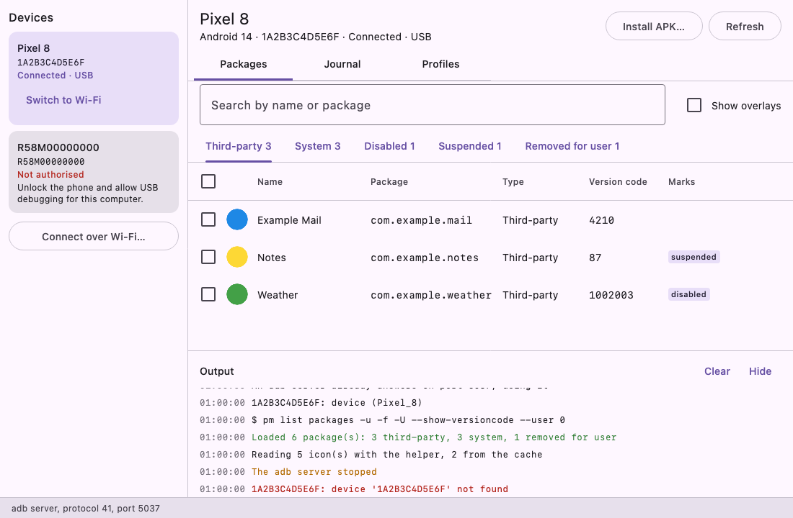
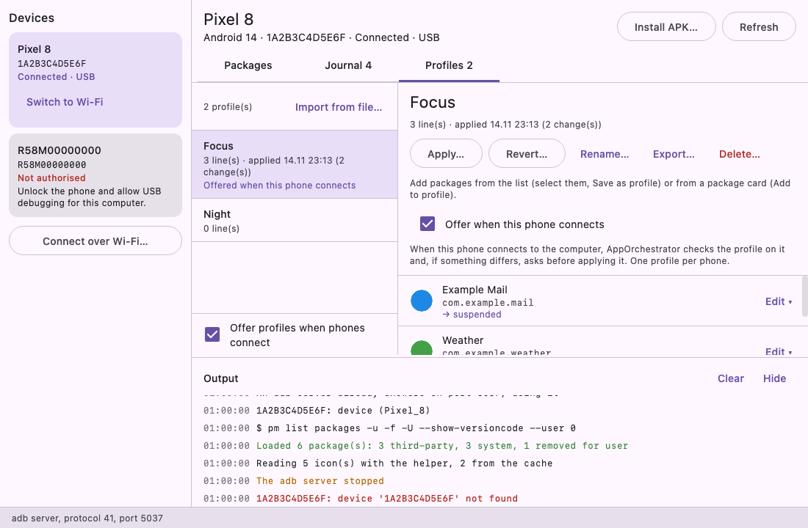
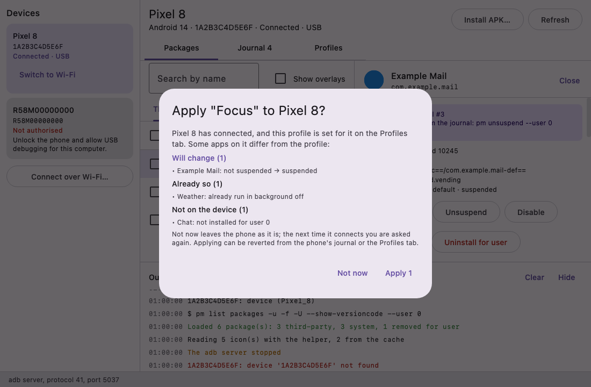

# AppOrchestrator user guide

AppOrchestrator manages the apps on your Android phone from your computer. It can stop, suspend,
disable and restrict them, change their permissions, battery and language settings, install APK
files, run batches and profiles, and keep a journal that undoes every change. It works over USB
debugging (or Wireless debugging), with no root and nothing installed on the phone.

How to download, start AppOrchestrator and connect a phone is on the
[download page](README.md). This guide is about using it.

## Contents

1. [How it works](#1-how-it-works)
2. [The window](#2-the-window)
3. [The package list](#3-the-package-list)
4. [The package card](#4-the-package-card)
5. [What each action does](#5-what-each-action-does)
6. [Protection and confirmations](#6-protection-and-confirmations)
7. [The journal and undo](#7-the-journal-and-undo)
8. [Batch actions](#8-batch-actions)
9. [Profiles](#9-profiles)
10. [Installing APK files](#10-installing-apk-files)
11. [Troubleshooting](#11-troubleshooting)
12. [Limits](#12-limits)
13. [Privacy](#13-privacy)

## 1. How it works

Android lets a computer control a phone over ADB (Android Debug Bridge) once **USB debugging** is
on and the phone trusts the computer. AppOrchestrator talks to `adb` on your computer and runs the
same commands you could type after `adb shell`: `pm`, `appops`, `cmd`. It has the rights of that
shell, not root.

To show app names, icons and languages, it puts a small helper program in the phone's temporary
folder (`/data/local/tmp`) and runs it there. Nothing is installed on the phone, and nothing stays
running after AppOrchestrator is closed.

Before every change AppOrchestrator reads the app again and writes the change into the phone's
journal, so that it can be undone. Each phone has its own journal on the computer.

## 2. The window

* **Devices**, on the left: every phone adb sees, with its state. Click one to work with it. A
  phone on the cable has **Switch to Wi-Fi**, a phone over Wi-Fi has **Disconnect**.
  **Connect over Wi-Fi…** adds a phone without a cable ([download page](README.md#over-wi-fi)).
* **The selected phone**: its model, Android version and how it is connected. **Install APK…** and
  **Refresh** are at the top right.
* **Tabs**: **Packages**, **Journal** and **Profiles** of that phone. The number is how many entries
  or profiles there are.
* **Output**, at the bottom: every command AppOrchestrator sends and what the phone answers. Drag
  its top edge to make it taller; **Hide** folds it away.
* **The status bar**: whether the adb server runs, and on which port.

Keys: **F5** or **Ctrl+R** (**Cmd+R** on macOS) reads the list again, **Ctrl+F** (**Cmd+F**) goes to
the search, **Escape** closes the card or clears the selection.

## 3. The package list

* **Tabs**: *Third-party*, *System*, *Disabled*, *Suspended*, *Removed for user*. The number is how
  many apps are in the tab.
* **Search** looks at the app name and the package name, in every tab at once.
* **Show overlays**: overlay packages (themes and resource overlays) are hidden by default.
* **Marks**: `suspended`, `disabled`, `archived`, `updated` (a system app with an update installed),
  `priv-app` (a privileged system app), `overlay`, `protected`.
* Click a row to open its [card](#4-the-package-card) on the right.
* Tick the box at the start of a row to select it for a [batch action](#8-batch-actions).

The list is read when the phone connects, on **Refresh**, after AppOrchestrator's own changes, when
you come back to the window after more than 30 seconds, and when a check every 5 seconds sees that
something changed on the phone itself.

## 4. The package card

The top shows the type, uid, version, install path, installer and state. Below are:

* **Buttons** for one-off actions. Which ones appear depends on the app: an updated system app has
  **Uninstall updates**, a removed one has **Restore for user**.
* **Add to profile…**: save one of this app's states into a [profile](#9-profiles).
* **Permissions**: a switch per runtime permission. Permissions fixed by the system are greyed out.
* **Background**: *Run in background*, *Background services (legacy apps)*, *Battery optimization*,
  *Background mobile data*.
* **Notifications**: *Show notifications*.
* **Links**: *Open supported links*, only for apps that open web addresses.
* **Language**: the app's own language (Android 13+).

Each action reads the app again before it runs, so a card that is a few minutes old is never
dangerous. When a change is done, the card says how to undo it.

## 5. What each action does

For each action: what it does in plain words, when it helps, what to watch out for and how to undo
it. Under **How it works** is the exact command.

### Force stop

Closes the app at once, like **Force stop** in Settings. It stays stopped until something starts it
again: you, a notification, another app. Useful when an app hangs or drains the battery. Nothing to
undo.

How it works

`am force-stop --user 0 <package>`

### Suspend / Unsuspend

A suspended app stays installed with all its data, but its icon turns grey: it cannot be opened, it
does not run, and its notifications are hidden. Useful for apps you want out of the way for a while,
like games during work. **Unsuspend** brings it back exactly as it was.

Android keeps a separate suspension for each one who suspends an app, and only that one can lift it.
If root or another app (such as Digital Wellbeing) suspended it, the **State** line says who, for
example *suspended by root*, a note explains it, and there is no **Unsuspend** button.

How it works

`pm suspend --user 0 <package>` / `pm unsuspend --user 0 <package>`. `dumpsys package` lists who
suspended it (`suspendingPackage=`): `com.android.shell` for adb and AppOrchestrator, `root` for a root
shell.

### Disable / Enable

A disabled app disappears from the launcher and cannot run at all, as if removed, but it stays on
the phone with its data. Useful for preinstalled apps you never use. Disabling a system component
can break features that depend on it, which is why system parts are protected
([section 6](#6-protection-and-confirmations)). **Enable** turns it back on.

How it works

`pm disable-user --user 0 <package>` / `pm enable --user 0 <package>`. Undo puts back the exact
state from before: `pm default-state` for an app that was in its default state. The shell can only
set "disabled by user", so an app that was disabled in another way comes back as "disabled by
user"; the journal marks such an undo as approximate.

### Clear data

Deletes everything the app has stored: sign-ins, settings, downloaded files, caches. The app starts
as if freshly installed. **Cannot be undone**; it always asks first.

How it works

`pm clear --user 0 <package>`

### Archive / Restore from archive (Android 15+)

Archiving removes the app itself (its APK) and its cache but **keeps its data, sign-ins and settings,
and its icon**. To use it again, tap the icon on the phone or press **Restore from archive**: the
store that installed it (for example Google Play) downloads it again and it opens as before. Useful
to free space taken by apps you rarely use without setting them up again later. The list shows
archived apps under *Removed for user* with the `archived` mark.

Watch out: restoring needs the internet, and the app must still be available in its store. Apps
installed from an APK file have no store to come back from, so they cannot be archived. Archiving is
never done in batches or profiles.

How it works

`pm archive --user 0 <package>` / `pm request-unarchive --user 0 <package>`. The restore is done by
the store after the command returns.

### Uninstall for user / Restore for user

Removes the app for you (user 0) and keeps its files on the phone where the system allows.

* **System apps** keep their copy on the phone, so they can always be restored from the *Removed for
  user* tab with **Restore for user**.
* **Third-party apps** can be restored only while another user or work profile on the phone still
  has the app. Otherwise the APK is deleted and the app can only be installed again. The
  confirmation tells you which case applies.

How it works

`pm uninstall -k --user 0 <package>` / `cmd package install-existing --user 0 <package>`. App clones
(for example Xiaomi's Second space for apps) do not count as another user: they lose their copy
together with you.

### Disable or uninstall for user?

| | Disable | Uninstall for user |
|---|---|---|
| The app | Stays installed but cannot run: no icon, no services, no notifications. | Is not installed for you any more. |
| Who sees it | The phone's Settings list it as disabled; other apps see it is there. | The phone's Settings and other apps do not see it. |
| Tab | *Disabled* | *Removed for user* |
| Back | **Enable**, any time. | **Restore for user**: always for system apps, for third-party apps only while another user keeps them. |

Disable is the safe choice for preinstalled apps you do not use. Uninstall for user removes a system
app more thoroughly, and is still reversible.

**If an app cannot be disabled.** Disabling and uninstalling go through different checks in
Android, so one can be refused when the other is not:

* In the phone's own Settings the **Disable** button is greyed out for many preinstalled apps: apps
  signed by the system, the default launcher or SMS app, device administrators, and apps on the
  maker's list. Settings usually offers no "uninstall for this user" for system apps at all.
  AppOrchestrator does not go through these Settings rules, so **Disable** may work here where
  Settings does not allow it.
* Android itself, and the phone's maker with its own list, can refuse the disable command for some
  packages. AppOrchestrator then shows the phone's answer as it is, for example a
  `SecurityException` or `Cannot disable`. Uninstall for user takes another path and is often
  allowed for the same app; for a system app it can be undone with **Restore for user**.

### Uninstall for all users

Removes a third-party app and its data for **every** user of the phone, including the work profile
and app clones. To confirm, you type the package name.

Before uninstalling, AppOrchestrator copies the app's APK files to the computer, into the phone's
folder ([where](README.md#where-apporchestrator-keeps-its-files)). If the copy fails, nothing is
uninstalled. **Undo** in the journal installs the app again from that copy, with the store it came
from. **The app's data cannot come back.**

How it works

`pm path <package>`, the files copied over adb, then `pm uninstall <package>`. Undo pushes the copies
back to `/data/local/tmp`, runs `pm install -r -i <installer> <files>` and removes them again.

### Uninstall updates

For a system app with an update installed: removes the update and the app's data, and goes back to
the version the phone shipped with. The update comes back only from the store. **Cannot be undone.**

How it works

`pm uninstall <package>` on an updated system package.

### Permissions

Each switch grants or revokes one runtime permission (camera, location, contacts…). A revoked
permission is not final: the app can ask again and the system shows its usual dialog. Permissions
the system fixed cannot be changed. For apps that share a uid (some system apps), the change applies
to all of them, and the card says so.

How it works

`pm grant --user 0 <package> <permission>` / `pm revoke --user 0 <package> <permission>`

### Run in background / Background services (legacy apps)

* **Run in background** off: the app may not run while you are not using it. This is the same as
  the *Restricted* battery setting in Settings. Good for apps that should only work while open.
* **Background services (legacy apps)** off: the same limit for apps built for old Android
  versions, which could start background services freely.

Messengers and alarm clocks with these off may deliver late or not at all.

How it works

`appops set --user 0 <package> RUN_ANY_IN_BACKGROUND ignore` and the same for `RUN_IN_BACKGROUND`.
Undo sets back the mode read before (`allow`, `ignore` or `default`).

### Battery optimization

When the phone lies still with the screen off, Android goes into **Doze**: apps lose network access
and their alarms and jobs wait for short maintenance windows. Turning **Battery optimization** off
exempts the app: it keeps network and alarms while the phone sleeps. This is the *Don't optimize*
option in Settings.

Useful for messengers whose notifications come late, smart home, health trackers, alarm apps. It
costs some battery. Some apps are exempted by the system itself: their switch is off and greyed out.

On Xiaomi phones the maker's own battery saver and **Autostart** setting work on top of Doze, so
this switch alone may not be enough. Autostart cannot be changed over ADB; set it in the Security
app.

How it works

`cmd deviceidle whitelist +<package>` / `-<package>`. `cmd deviceidle whitelist` lists
`user,<package>,<uid>` for an exemption you can remove, `system,<package>,<uid>` for one from the
system that you cannot.

### Background mobile data

Off: while the app is in the background it may not use mobile data or a Wi-Fi network marked as
metered. On ordinary Wi-Fi, and while you use the app, it works as usual. This is the *Background
data* switch in the app's data usage settings. Useful to save mobile data, for example when
travelling.

Some system apps share one user ID (uid); the restriction then applies to all of them, and
AppOrchestrator asks before it does that. Apps that run as the system itself are never touched.

How it works

`cmd netpolicy add restrict-background-blacklist <uid>` / `remove …`. The restriction is on the uid,
not the package name, so the uid is read right before the change.

### Show notifications

Off: the app keeps sending notifications, but the system hides them: no sound, nothing in the shade.
The app is not told. When you turn it back on, the notifications it has not withdrawn in the
meantime appear. Useful to silence a pushy app for a while without losing anything and without the
app nagging you to turn notifications back on.

This is different from turning notifications off in Settings: then the app knows, and the
notifications are gone for good.

How it works

`pm set-distracting-restriction --user 0 --flag hide-notifications <package>`; the same command
without `--flag` shows them again.

### Open supported links

When you tap a link in a browser or messenger, Android opens it in the app that owns that website,
for example a YouTube link in YouTube. Off: links to this app's websites open in the browser. The
card lists the websites the app has verified.

How it works

`pm set-app-links-allowed --user 0 --package <package> false` / `true`. The state comes from
`pm get-app-links --user 0 <package>`.

### App language (Android 13+)

Gives the app its own language, different from the phone's. **Change** opens a searchable list;
**System default** follows the phone again. The app switches only if it has a translation for that
language. Works on HyperOS too, where Settings hide this option.

How it works

`cmd locale set-app-locales <package> --user 0 --locales <language>`; without `--locales` the app
follows the system again.

## 6. Protection and confirmations

Some packages are vital for the phone. Their cards show a red **Protected** note: only
**Force stop** and actions that turn them back on are allowed, and they cannot be selected for a
batch.

Protected: System UI, Settings, the shell, the phone and telephony services, the permission
controller, the package installer, network and storage providers, a few Xiaomi security packages,
the current launcher and keyboard, and every system home app.

Packages that need care show a **Caution** note and ask for confirmation: Google Play services,
Google Services Framework and the Play Store (push notifications, Google sign-in, purchases and Play
updates depend on them), WebView, Bluetooth, NFC, fused location, packages running as a system uid,
privileged apps and Google system modules.

Actions that cannot be undone, and every change to a *Caution* package, ask first and say what will
happen.

## 7. The journal and undo

Every command AppOrchestrator sends is recorded in the phone's journal **before** it is sent. The
**Journal** tab shows it.

Each entry shows the command, the state before and the undo command. Marks:

* `OK`: done and confirmed by reading the app again.
* `FAILED`: the phone refused, or the app did not reach the expected state.
* `UNKNOWN`: the connection broke while the command ran. When the phone is back, AppOrchestrator
  reads the package and settles the entry.
* `reverted`: undone. `undo of #N`: this entry is itself an undo. `batch`: part of a batch or
  profile.

**Undo** reads the app again first:

* already back to the state before: nothing is sent, the entry is marked reverted;
* changed in some other way since: you are asked **Undo anyway?** with the current, expected and
  restored values.

**Undo whole batch** undoes every entry of a batch or profile. **Active changes** shows only changes
that are still in effect. **Export to file…** saves the journal as JSON. The journal is kept on the
computer, in the phone's folder, so it survives a reset of the phone.

## 8. Batch actions

Select apps with the box at the start of a row or **Ctrl+click** (**Cmd+click** on macOS);
**Shift+click** adds the range from the last one, and the box in the header takes everything in the
current tab and search. Protected apps and apps removed for the user cannot be selected.

The bar offers **Force stop**, **Suspend**, **Unsuspend**, **Disable** and **Enable**, and **Save as
profile…**. Clearing data, archiving and uninstalling are never done in batches. A batch asks first.
It then runs one app at a time with a **Stop** button and skips apps that are already in that state.
All entries share one journal group, and **Undo whole batch** undoes them together.

## 9. Profiles

A profile is a saved set of states: "these apps suspended, that one without background data, this
one with notifications hidden". Apply it with one click, revert it later. Profiles are shared by
every phone.

* **Create**: select apps and press **Save as profile…**, or use **Add to profile…** in a card.
* **Edit**: open a profile on the **Profiles** tab. **Edit ▾** on a line (or a right click) switches
  it to the opposite state or removes it. **Rename…**, **Export…** and **Delete…** are above the
  lines.
* **Apply…** shows a preview first, grouped into *Will change*, *Already so*, *Not on the device*,
  *Protected, skipped* and *Does not apply, skipped*. Applying a profile that is already in effect
  changes nothing.

  

* **Revert…** undoes the last application on this phone. Apps that were already in the profile's
  state before stay as they are.
* **Export… / Import from file…**: a profile as a JSON file, the same format as AppOrchestrator for
  Android uses. Import drops lines with invalid package names, protected packages or actions a
  profile cannot hold, and lists what it dropped.

A profile can hold: suspended, disabled, permissions, background, battery optimization, background
data, notifications, links and language. It never holds force stop, clearing data, archiving or
uninstalling.

### A phone's profile when it connects

A phone can have one profile set for it: open the profile while that phone is selected and tick
**Offer when this phone connects**. Each time the phone connects to the computer while
AppOrchestrator runs, over USB or Wi-Fi, AppOrchestrator reads the apps of the profile on it. If any
of them differs from the profile (for example an update turned something back on), it asks first,
with the same preview as **Apply…**:

**Apply** changes only what differs, as one group in the phone's journal; **Not now** leaves the
phone as it is. The phone does not have to be the selected one.

A phone that comes back within ten minutes counts as still connected: Wi-Fi drops for a moment, the
cable is plugged in again, or **Switch to Wi-Fi**. It is not asked about again. A phone that is
already connected when AppOrchestrator starts counts as just connected.

**Offer profiles when phones connect**, below the list of profiles, turns this off for every phone
at once.

## 10. Installing APK files

Press **Install APK…** at the top, or drag the files onto the window. Choose one `.apk`, or all the
APK files of one app (a base APK and its split APKs). AppOrchestrator reads them first and says what
will happen:

* **A new app.** **Undo** in the journal uninstalls it again, with its data. If the phone asks
  whether to install the app, tap **Install** there. Xiaomi phones ask only for 10 seconds and then
  deny it, and only if **Developer options → Install via USB** is on; turning it on may need you to
  sign in with a Mi account.
* **An update.** It cannot be undone: Android does not install an older version over a newer one.
* **The same version** again: the app keeps its data.
* **An older version** than the phone has is not installed.

**Installer** says which store Android records as where the app came from. That store updates it,
and the app's settings name it. An update keeps the app's own store at first; a new app has none,
as for any app installed over USB. You can pick none, or a store that is on the phone: Google Play,
GetApps, Galaxy Store, F-Droid and others. Then an app from Google Play whose APK came from somewhere
else keeps getting its updates from Google Play, if it is signed by the same developer. Android
believes whatever store it is told, so choose the one the app really comes from. The app itself can
still see that it was installed over USB.

AppOrchestrator turns the phone's screen on before each install: the phone may ask something, for
example Google Play Protect whether to send an app it does not know for a check. Answer there.

Archives such as `.apks` or `.xapk` are not supported yet: unpack them and choose the `.apk` files
inside.

How it works

The files go to `/data/local/tmp`, then `pm install -r [-i <installer>] <files>`; the files are
removed again in any case.

## 11. Troubleshooting

| What you see | What to do |
|---|---|
| No phone in **Devices** | Check that USB debugging is on and that the cable carries data (some cables only charge). On Windows the phone may need its maker's USB driver. |
| *Not authorised* | Unlock the phone and allow USB debugging for this computer. |
| A phone on the cable stops answering | Turn its screen on, or plug the cable in again. |
| *The adb server stopped; reconnecting…* | Another program (Android Studio, `adb` in a terminal) restarted adb. AppOrchestrator connects again by itself. |
| A Wi-Fi phone does not connect | The port changes every time Wireless debugging is turned on: use the address on the phone's Wireless debugging screen now. |
| Network search lists one phone twice | One of the entries can be an old announcement that the phone did not withdraw; connecting to it fails. Use the other one. Turning USB debugging off and on removes the old entry. |
| *Install canceled by user* on a Xiaomi phone | Turn on **Developer options → Install via USB** and tap **Install** on the phone within 10 seconds. |
| An install waits | Look at the phone: Google Play Protect may be asking a question. |
| An action says *Refused: Protected* | The package is protected ([section 6](#6-protection-and-confirmations)). |
| An action says *Failed* | The journal entry has the phone's answer. The phone refuses some changes for some packages by itself. |

## 12. Limits

AppOrchestrator has the rights of `adb shell`, not root. It cannot:

* disable single parts of an app (an activity, a service or a tracker inside it);
* unsuspend an app that root or another app suspended (only they can);
* change Xiaomi's **Autostart** setting;
* work on other users, the work profile or app clones: everything is for user 0;
* work with several phones at once: it lists them all, and you work with the selected one;
* install `.apks`, `.xapk` or `.apkm` archives.

## 13. Privacy

AppOrchestrator collects and sends nothing. What it reads from the phone stays on your computer, in
its folder ([where](README.md#where-apporchestrator-keeps-its-files)): each phone's journal, the
profiles, the settings and the APK copies saved before **Uninstall for all users**. The only network
traffic is adb's own: to the phone over Wi-Fi, and the one-time download of Platform-Tools from
Google if you choose it.
